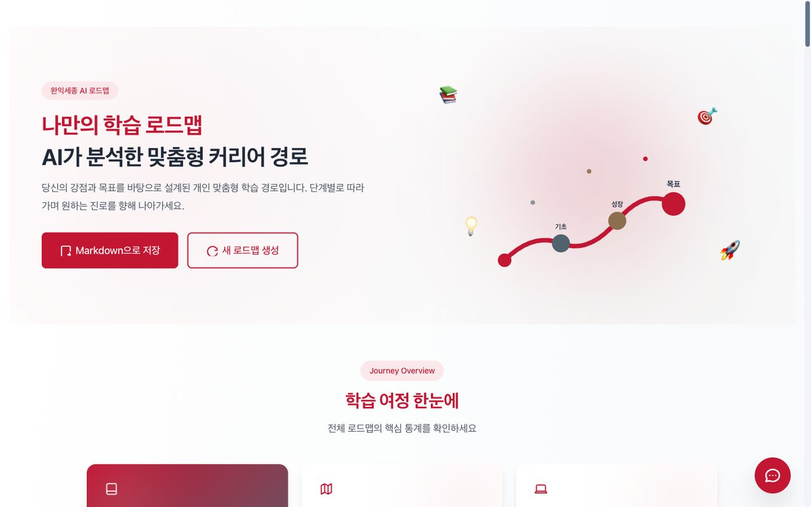
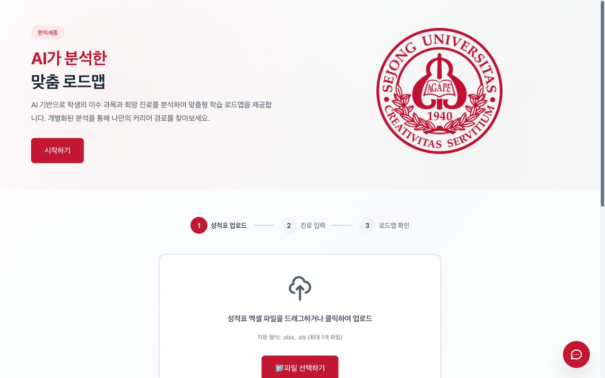
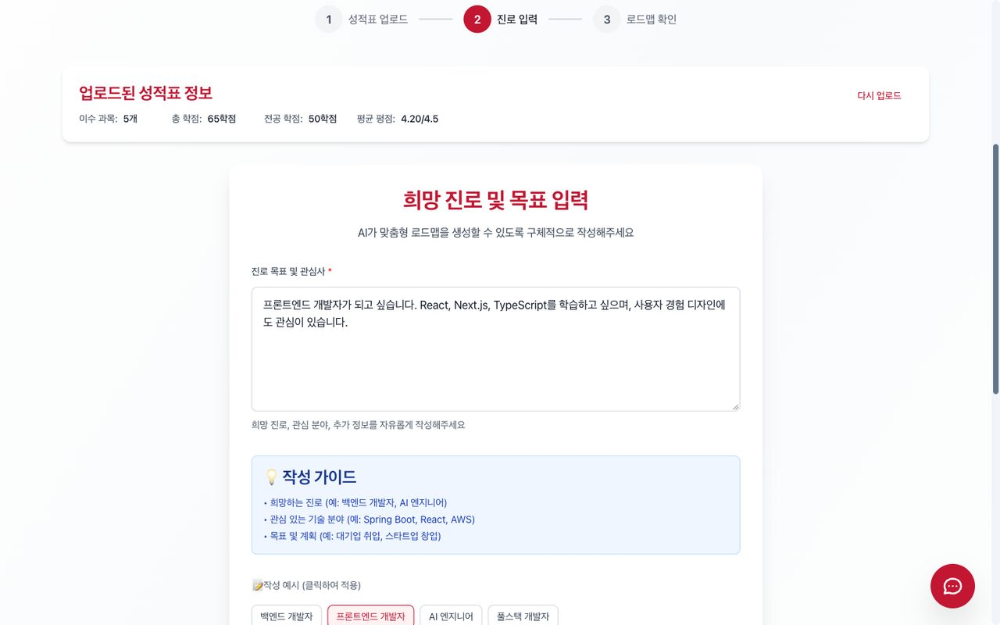
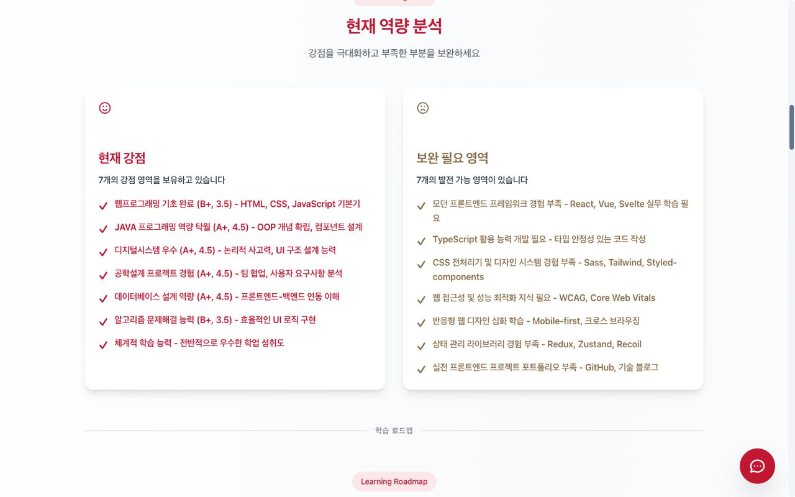
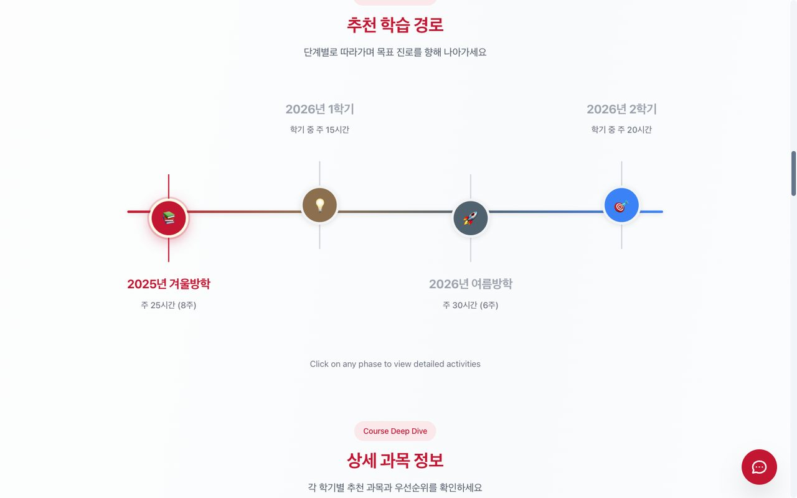
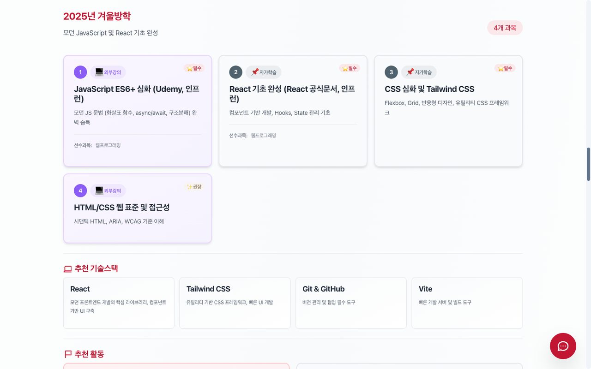

<div align="center">



# 🎓 완익세종 (Wanik-Sejong)

**AI 기반 진로-교과목 로드맵 추천 서비스**

성적표를 올리고 희망 진로를 적으면, AI가 학기별 과목과 방학 활동까지 담은 나만의 로드맵을 만들어 줍니다.

🏆 **제13회 세종대학교 SW-AI 해커톤 장려상** · 팀 **완익세종**


</div>

---

## 💡 왜 만들었나

> "AI 엔지니어가 되고 싶은데, 어떤 과목을 들어야 하지?"<br />
> "선후수 관계는 어떻게 되지?"<br />
> "방학에는 뭘 해야 취업에 도움이 될까?"

저희 팀도, 주변 친구들도 하던 고민입니다. 세종대 학생들은 수강편람을 일일이 찾아보거나 선배에게 묻고, 방학 계획은 막연하게 세우곤 합니다. 완익세종은 이 과정을 **세 단계**로 줄였습니다.

| 1. 성적표 업로드 | 2. 진로 입력 | 3. AI 로드맵 |
|:---:|:---:|:---:|
| 포털에서 받은 기이수성적 Excel을 드래그 앤 드롭 | 희망 진로·관심 분야·목표를 자유롭게 작성 | 역량 분석 + 학기별 과목 + 방학 활동 + 추천 기술스택 |

## 📸 화면

| 시작 화면 | 진로 입력 |
|:---:|:---:|
|  |  |
| **현재 역량 분석** | **추천 학습 경로** |
|  |  |
| **학기별 상세 과목** | **로드맵 결과** |
|  |  |

<sub>스크린샷은 Mock 모드(테스트 데이터)로 촬영했습니다. 만든 로드맵은 체크리스트가 포함된 Markdown 파일로 저장할 수 있습니다.</sub>

## 👥 팀 완익세종

- **홍의민** — 프론트엔드 (Next.js 화면 · API Routes · AI 챗봇 세박사 · 백엔드 연동)
- **이정연**
- **박성열**

---

## 🎯 주요 기능

1. **📊 성적표 업로드** - Excel 파일 드래그 앤 드롭 지원
2. **🎓 진로 입력** - 희망 진로 및 관심 분야 입력
3. **🤖 AI 로드맵 생성** - Google Gemini 2.0 Flash 기반 맞춤형 학습 경로 추천
4. **💬 AI 챗봇 (세박사)** - 과목/교수/시간표 검색 및 학업 상담
5. **📈 역량 분석** - 현재 강점과 보완 필요 영역 분석
6. **🗓️ 타임라인 뷰** - 학기별 추천 과목, 기술스택 및 활동 제시
7. **🎨 인터랙티브 UI** - Framer Motion 기반 부드러운 애니메이션

---

## 🚀 빠른 시작

### 1. 의존성 설치

```bash
npm install
```

### 2. 환경 변수 설정

`.env.local` 파일 생성 후 운영 모드에 맞게 설정:

#### Mode 1: Mock Mode (개발용, API 호출 없음) - 추천 🟢

```bash
NEXT_PUBLIC_USE_MOCK=true
GEMINI_API_KEY=your_key_here
NEXT_PUBLIC_API_URL=http://localhost:3000
```

#### Mode 2: Local Mode (Gemini AI 사용)

```bash
NEXT_PUBLIC_USE_MOCK=false
GEMINI_API_KEY=your_actual_gemini_api_key
NEXT_PUBLIC_API_URL=http://localhost:3000
```

#### Mode 3: Backend Mode (Spring Boot API 사용)

```bash
NEXT_PUBLIC_USE_MOCK=false
GEMINI_API_KEY=your_key_here
NEXT_PUBLIC_API_URL=https://hackathon.yeo-li.com
```

**Gemini API Key 발급**: https://makersuite.google.com/app/apikey

### 3. 개발 서버 실행

```bash
npm run dev
```

브라우저에서 [http://localhost:3000](http://localhost:3000) 접속

---

## 🔧 운영 모드 (3가지)

### 1. Mock Mode (개발 모드) 🟢

- **설정**: `NEXT_PUBLIC_USE_MOCK=true`
- **특징**: 완전 오프라인, API 호출 없음
- **데이터**: [src/mocks/](src/mocks/) JSON 파일 사용
- **API**: Mock 서비스 ([src/lib/mock-service.ts](src/lib/mock-service.ts))
- **용도**: 로컬 개발 및 UI 테스트
- **장점**: 빠르고 안정적, API 키 불필요

### 2. Local Mode (Gemini AI 모드)

- **설정**: `NEXT_PUBLIC_USE_MOCK=false` + `localhost`
- **AI**: Google Gemini 2.0 Flash Experimental
- **필수**: `GEMINI_API_KEY` 환경변수
- **데이터**: 실제 Excel 파싱 + AI 로드맵 생성
- **API**: Next.js API Routes ([src/app/api/](src/app/api/))
- **용도**: AI 기능 테스트 및 검증
- **특징**: 10-20초 소요 (AI 생성 시간)

### 3. Backend Mode (외부 API 모드)

- **설정**: `NEXT_PUBLIC_USE_MOCK=false` + 외부 URL
- **백엔드**: Spring Boot API (hackathon.yeo-li.com)
- **특징**: 백엔드 서버가 AI 처리 담당
- **자동 감지**: URL 기반 자동 모드 전환
- **용도**: 프로덕션 환경
- **장점**: 서버 리소스 활용, 안정적 처리

**모드 전환 로직**: [src/lib/config.ts](src/lib/config.ts)와 [src/lib/api-client.ts](src/lib/api-client.ts)에서 자동 처리

---

## 📁 프로젝트 구조

```
wanik-sejong/
├── src/
│   ├── app/                       # Next.js 16 App Router
│   │   ├── page.tsx              # 홈페이지 (업로드 + 진로 입력)
│   │   ├── roadmap/page.tsx      # 로드맵 결과 페이지
│   │   ├── showcase/page.tsx     # UI 컴포넌트 쇼케이스
│   │   └── api/                  # API Routes
│   │       ├── parse-excel/route.ts      # Excel 파싱
│   │       ├── generate-roadmap/route.ts # AI 로드맵 생성
│   │       └── chatbot/route.ts          # 챗봇 API
│   ├── components/
│   │   ├── FileUpload.tsx        # 성적표 업로드 컴포넌트
│   │   ├── CareerInput.tsx       # 진로 입력 컴포넌트
│   │   ├── RoadmapDisplay.tsx    # 로드맵 표시 컴포넌트
│   │   ├── chatbot/              # AI 챗봇 시스템 (세박사)
│   │   │   ├── ChatbotProvider.tsx
│   │   │   ├── ChatWindow.tsx
│   │   │   ├── FloatingChatButton.tsx
│   │   │   ├── ChatMessage.tsx
│   │   │   ├── ChatInput.tsx
│   │   │   ├── ResizeHandle.tsx
│   │   │   └── TypingIndicator.tsx
│   │   ├── roadmap/              # 로드맵 컴포넌트
│   │   │   ├── TimelineRoadmap.tsx
│   │   │   ├── RoadmapCarousel.tsx
│   │   │   ├── PhaseDetailModal.tsx
│   │   │   ├── CourseCard.tsx
│   │   │   ├── TechStackCard.tsx
│   │   │   └── ActivityCard.tsx
│   │   └── ui/                   # shadcn 스타일 UI 라이브러리
│   ├── lib/
│   │   ├── config.ts             # 3가지 모드 설정
│   │   ├── types.ts              # TypeScript 타입 정의
│   │   ├── api-client.ts         # API 클라이언트 (모드 전환)
│   │   ├── mock-service.ts       # Mock 서비스
│   │   └── chatbot/              # 챗봇 로직
│   │       ├── search-engine.ts  # 로컬 검색 엔진
│   │       └── types.ts
│   ├── mocks/
│   │   ├── courses.json          # Mock 성적표 데이터
│   │   ├── roadmap-backend.json  # Mock 백엔드 로드맵
│   │   ├── roadmap-frontend.json # Mock 프론트엔드 로드맵
│   │   └── roadmap-server.json   # Mock DevOps 로드맵
│   ├── fonts/
│   │   └── pretendard.ts         # Pretendard 폰트 정의
│   └── styles/
│       └── colors.ts             # 세종대 브랜드 컬러 시스템
├── public/
│   ├── fonts/                    # Pretendard 폰트 파일 (.ttf)
│   └── mocks/
│       └── sejong_courses.json   # 세종대 과목 데이터 (챗봇용)
├── docs/
│   ├── PRD.md                    # 프로덕트 요구사항 문서
│   ├── Simple-PRD.md             # 간소화된 PRD (MVP)
│   ├── WORKFLOW.md               # 48시간 해커톤 워크플로우
│   ├── WORKFLOW-SIMPLE.md        # 24시간 MVP 워크플로우
│   └── COMPONENTS.md             # UI 컴포넌트 문서
└── claudedocs/
    ├── API_DOCUMENTATION.md      # 완전한 API 스펙
    └── GITHUB_ACTIONS_SECRETS.md # CI/CD 설정 가이드
```

---

## 💬 AI 챗봇 (세박사)

세종대학교 컴퓨터공학과 학생을 위한 AI 학업 도우미

### 주요 기능
- **과목 검색**: 과목명, 교수명, 강의 시간으로 검색
- **AI 대화**: Google Gemini 기반 자연어 대화
- **로컬 검색**: API 없이도 작동하는 오프라인 검색 (Fallback)
- **대화 기록**: 최근 대화 기록 유지 (5개)
- **Markdown 렌더링**: 코드 블록, 표, 리스트 지원

### 기술 구성
- **프론트엔드**: ChatWindow, FloatingChatButton (Framer Motion 애니메이션)
- **검색 엔진**: [src/lib/chatbot/search-engine.ts](src/lib/chatbot/search-engine.ts)
- **AI API**: [src/app/api/chatbot/route.ts](src/app/api/chatbot/route.ts)
- **데이터**: [public/mocks/sejong_courses.json](public/mocks/sejong_courses.json)

### 사용법
1. 화면 우측 하단 챗봇 버튼 클릭
2. 과목명, 교수명, 시간대 등 자유롭게 질문
3. AI가 과목 정보 검색 및 답변 제공
4. API 오류 시 자동으로 로컬 검색으로 전환

### 챗봇 아키텍처
```
ChatbotProvider (Root Layout)
  └─ FloatingChatButton
      └─ ChatWindow (resizable, draggable)
          ├─ ChatMessage (Markdown rendering)
          ├─ ChatInput (keyboard shortcuts)
          └─ TypingIndicator (loading state)
```

---

## 🎨 UI 컴포넌트 라이브러리

shadcn/ui 스타일의 재사용 가능한 컴포넌트:

- **Layout**: Card, Hero, ProcessFlow, Timeline
- **Form**: Input, Textarea, Select, Button
- **Data Display**: DonutChart, BarChart, ProgressBar
- **Badge**: Badge, Tag, StatusBadge
- **Roadmap**: TimelineRoadmap, RoadmapCarousel, PhaseDetailModal
- **Interactive**: ResizeHandle, NavigationDots

자세한 사용법: [docs/COMPONENTS.md](docs/COMPONENTS.md)

컴포넌트 쇼케이스: [http://localhost:3000/showcase](http://localhost:3000/showcase)

---

## 🔄 워크플로우

### 사용자 플로우

1. **성적표 업로드** → 2. **진로 입력** → 3. **AI 로드맵 확인**

### 기술 플로우 (Mock Mode)

```
FileUpload → parseExcel (mock) → CareerInput → generateRoadmap (mock) → RoadmapDisplay
```

### 기술 플로우 (Local Mode)

```
FileUpload → /api/parse-excel (xlsx) → CareerInput → /api/generate-roadmap (Gemini) → RoadmapDisplay
```

### 기술 플로우 (Backend Mode)

```
FileUpload → {backend}/api/parse-excel → CareerInput → {backend}/api/generate-roadmap → RoadmapDisplay
```

---

## 🧪 테스트

### Mock 모드에서 테스트 (권장 🟢)

1. 서버 실행: `npm run dev`
2. Mock 모드 확인: 홈페이지 상단에 "개발 모드 (Mock Data)" 뱃지 표시
3. 아무 Excel 파일이나 업로드 (파일 내용 무시, mock 데이터 사용)
4. 진로 입력:
   - "백엔드" / "AI/ML" / "데이터" → Backend 로드맵
   - "프론트엔드" / "웹" / "모바일" → Frontend 로드맵
   - "DevOps" / "인프라" / "클라우드" → Server 로드맵
5. 로드맵 확인: Mock 데이터 즉시 표시

### Local Mode 테스트 (Gemini AI)

1. `.env.local` 수정:
   ```
   NEXT_PUBLIC_USE_MOCK=false
   GEMINI_API_KEY=your_actual_api_key
   NEXT_PUBLIC_API_URL=http://localhost:3000
   ```
2. 서버 재시작: `npm run dev`
3. 실제 세종대 성적표 Excel 파일 업로드
4. 진로 입력 후 AI 로드맵 생성 (10-20초 소요)

### 챗봇 테스트

1. 우측 하단 챗봇 버튼 클릭
2. 다음 질문 시도:
   - "김영철 교수님 강의 알려줘"
   - "월요일 오전 과목 뭐 있어?"
   - "운영체제 수업 언제야?"
3. AI 응답 또는 로컬 검색 결과 확인

---

## 📦 빌드 & 배포

### 빌드

```bash
npm run build
```

### 프로덕션 실행

```bash
npm start
```

### Vercel 배포

1. GitHub에 푸시
2. Vercel에 프로젝트 import
3. 환경 변수 설정:
   - `NEXT_PUBLIC_USE_MOCK=false`
   - `GEMINI_API_KEY=your_key`
   - `NEXT_PUBLIC_API_URL=https://your-domain.com` (또는 `http://localhost:3000`)
4. 자동 배포

---

## 🛠️ 기술 스택

- **Framework**: Next.js 16 (App Router)
- **Language**: TypeScript 5
- **Styling**: Tailwind CSS 4
- **AI**: Google Gemini 2.0 Flash Experimental
- **Animation**: Framer Motion 12
- **Excel Parsing**: xlsx
- **Markdown**: react-markdown, remark-gfm
- **File Upload**: react-dropzone
- **Font**: Pretendard (Korean web font, 9 weights)
- **State**: React 19.2.3 (useState, sessionStorage)

---

## 🎯 브랜드 컬러

세종대학교 공식 브랜드 컬러:

- **Primary**: #C31632 (Sejong Crimson)
- **Secondary**: #51626F (Sejong Gray)
- **Gold**: #8B6F4E (Sejong Gold)

자세한 컬러 시스템: [src/styles/colors.ts](src/styles/colors.ts)

---

## 📝 API 문서

### 완전한 API 문서

프로덕션 모드로 전환하거나 API를 통합할 때 필요한 상세 문서:

- **[API Documentation](claudedocs/API_DOCUMENTATION.md)** - 완전한 API 스펙, Request/Response 예제, 에러 처리
- **[GitHub Actions Secrets 설정](claudedocs/GITHUB_ACTIONS_SECRETS.md)** - CI/CD 환경 변수 설정 가이드

### 빠른 참조: API 엔드포인트

#### POST /api/parse-excel

성적표 Excel 파일을 파싱하여 과목 데이터 추출

**Request**:
- Content-Type: `multipart/form-data`
- Body: `file` (Excel)

**Response**:
```json
{
  "success": true,
  "data": {
    "courses": [
      {
        "courseName": "자료구조",
        "credits": 3,
        "grade": "A+",
        "courseType": "전공필수"
      }
    ],
    "totalCredits": 34,
    "totalMajorCredits": 21,
    "totalGeneralCredits": 13,
    "averageGPA": 4.12
  }
}
```

#### POST /api/generate-roadmap

Google Gemini AI 기반 맞춤형 학습 로드맵 생성

**Request**:
```json
{
  "transcript": {
    "courses": [...],
    "totalCredits": 34,
    "averageGPA": 4.12
  },
  "careerGoal": {
    "careerPath": "AI/ML 엔지니어",
    "interests": ["AI/ML", "백엔드 개발"],
    "additionalInfo": "딥러닝에 관심 있습니다"
  }
}
```

**Response**:
```json
{
  "success": true,
  "data": {
    "careerSummary": "AI/ML 엔지니어는...",
    "currentSkills": {
      "strengths": ["자료구조", "알고리즘", "Python"],
      "gaps": ["머신러닝", "딥러닝", "통계학"]
    },
    "learningPath": [
      {
        "period": "2025년 겨울방학",
        "goal": "머신러닝 기초 다지기",
        "courses": [...],
        "techStacks": [
          {
            "name": "TensorFlow",
            "category": "framework",
            "reason": "딥러닝 프레임워크 표준",
            "priority": "high",
            "difficulty": 3,
            "resources": [...]
          }
        ],
        "activities": ["Kaggle 대회 참여"],
        "effort": "주 10시간 (8주)"
      }
    ],
    "advice": "추가 조언...",
    "generatedAt": "2025-12-23T10:30:00Z"
  }
}
```

#### POST /api/chatbot

Google Gemini 기반 자연어 대화 및 과목 검색

**Request**:
```json
{
  "message": "김영철 교수님 강의 알려줘",
  "courseContext": [
    {
      "교과목명": "운영체제",
      "교수명": "김영철",
      "요일 및 강의시간": "월(09:00-10:50)"
    }
  ],
  "conversationHistory": [
    {
      "role": "user",
      "content": "안녕하세요"
    },
    {
      "role": "assistant",
      "content": "안녕하세요! 무엇을 도와드릴까요?"
    }
  ]
}
```

**Response**:
```json
{
  "success": true,
  "message": "김영철 교수님의 강의는 다음과 같아요:\n\n📘 **운영체제**...",
  "fallbackToLocalSearch": false
}
```

**상세 정보**: [claudedocs/API_DOCUMENTATION.md](claudedocs/API_DOCUMENTATION.md) 참조

---

## 🤝 기여 가이드

1. Fork the repository
2. Create your feature branch (`git checkout -b feature/AmazingFeature`)
3. Commit your changes (`git commit -m 'Add some AmazingFeature'`)
4. Push to the branch (`git push origin feature/AmazingFeature`)
5. Open a Pull Request

---

## 📄 라이선스

© 2025 Sejong University. All rights reserved.

---

## 📞 문의

- **프로젝트**: 완익세종 (Wanik-Sejong)
- **목적**: 세종대학교 해커톤 프로젝트
- **팀**: 완익세종 (홍의민 · 이정연 · 박성열)

---

## ✨ 개발 팁

### Mock 데이터 수정

[src/mocks/](src/mocks/) 디렉토리의 JSON 파일들을 수정하여 다양한 시나리오 테스트 가능:
- `courses.json` - 성적표 데이터
- `roadmap-backend.json` - 백엔드 로드맵
- `roadmap-frontend.json` - 프론트엔드 로드맵
- `roadmap-server.json` - DevOps 로드맵

### 새 컴포넌트 추가

```bash
src/components/ui/MyComponent.tsx
```

생성 후 [src/components/ui/index.ts](src/components/ui/index.ts)에 export 추가

### Gemini AI 프롬프트 커스터마이징

[src/app/api/generate-roadmap/route.ts](src/app/api/generate-roadmap/route.ts)의 `createRoadmapPrompt` 함수 수정

### 챗봇 시스템 프롬프트 수정

[src/app/api/chatbot/route.ts](src/app/api/chatbot/route.ts)의 `buildSystemPrompt` 함수에서 세박사의 페르소나와 응답 스타일 조정

### 챗봇 검색 엔진 확장

[src/lib/chatbot/search-engine.ts](src/lib/chatbot/search-engine.ts)에 새로운 검색 로직 추가 (예: 학점 범위, 이수구분 필터)

### 폰트 커스터마이징

[src/fonts/pretendard.ts](src/fonts/pretendard.ts)에서 Pretendard 폰트 설정 수정 (weights, subsets)

### 타입 정의 확장

[src/lib/types.ts](src/lib/types.ts)에 새로운 타입 추가 시 API 응답과 프론트엔드 모두 반영

---

## 🔍 문제 해결

### Gemini API 에러

1. API 키 확인: `.env.local`에 `GEMINI_API_KEY` 정확히 입력
2. API 키 유효성: https://makersuite.google.com/app/apikey에서 키 상태 확인
3. 할당량 초과: 무료 API는 분당 요청 제한 있음 (대기 후 재시도)
4. Mock 모드로 전환: `NEXT_PUBLIC_USE_MOCK=true` 설정

### 챗봇이 응답하지 않음

1. Gemini API 키 확인
2. 브라우저 콘솔에서 에러 확인
3. API 에러 시 자동으로 로컬 검색으로 Fallback (Normal)
4. 네트워크 탭에서 `/api/chatbot` 응답 확인

### Excel 파싱 실패

1. Mock 모드 확인: Mock 모드는 파일 내용 무시
2. Local/Backend 모드: Excel 형식 확인 (세종대 성적표 형식)
3. 파일 크기 제한: Next.js는 기본 4MB 제한
4. 브라우저 콘솔에서 상세 에러 메시지 확인

### 폰트가 로드되지 않음

1. [public/fonts/](public/fonts/) 디렉토리에 Pretendard 폰트 파일 확인
2. [src/fonts/pretendard.ts](src/fonts/pretendard.ts) 경로 확인
3. 브라우저 Network 탭에서 폰트 로딩 상태 확인
4. Tailwind 설정에서 `--font-pretendard` CSS 변수 확인

---

## 🚧 알려진 제한사항

- **Gemini API 무료 티어**: 분당 요청 제한 있음 (대량 테스트 시 Mock 모드 사용 권장)
- **Excel 형식**: 세종대학교 성적표 형식만 지원 (다른 대학 성적표는 파싱 실패 가능)
- **챗봇 데이터**: 세종대 컴퓨터공학과 과목만 포함 (다른 학과 데이터 없음)
- **브라우저 호환성**: React 19 사용으로 IE11 미지원 (Chrome, Firefox, Safari, Edge 최신 버전 권장)

---

**Made with ❤️ for Sejong University Students**
